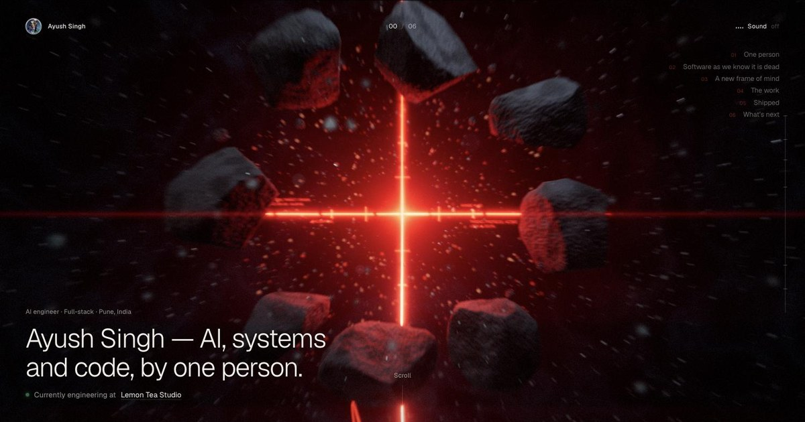

# Ayush Kumar Singh — Interactive Portfolio

<p align="center">
  <strong>A six-chapter, scroll-driven 3D portfolio built with Three.js, WebGL 2, custom GLSL and Vite.</strong>
  <br />
  One luminous red thread connects the scenes, the work and the story.
</p>

<p align="center">
  <a href="https://ayush-builds-sigma.vercel.app/">Live portfolio ↗</a> ·
  <a href="https://github.com/AyushCoder9">GitHub</a> ·
  <a href="https://www.linkedin.com/in/ayush-kumar-singh-910379320/">LinkedIn</a> ·
  <a href="mailto:ayushkumar1699@gmail.com">Email</a>
</p>

<p align="center">
  
</p>

## The experience

This is a portfolio presented as a small interactive film rather than a conventional grid of sections. Scrolling moves a choreographed camera through six connected environments; the same red thread passes through each one and eventually carries the central figure into the finale. The featured work is part of the environment: project panels float around a central glass form and open into case-study modals. [Explore the live experience](https://ayush-builds-sigma.vercel.app/).

| Chapter | Scene |
| --- | --- |
| 01 · Origin | Floating basalt, a targeting reticle and the first stretch of the thread |
| 02 · Memory | A fallen sculpted head, a thermal hologram and a scanning console |
| 03 · Refraction | A dispersive glass frame over a volcanic plain, with screen-pinned skill labels |
| 04 · The work | Six interactive project panels around the waking figure |
| 05 · Threshold | Procedural moonlit dunes, a glowing path and a red portal |
| 06 · Network | A cable-filled hall with animated dot-matrix tickers |
| Finale | The camera pulls back to reveal the connected world |

### Featured projects

Project copy, technology labels, screenshots and destinations are defined in [`src/data.js`](src/data.js). The full profile and 15-project index is a separate, low-bandwidth static page at [`public/archive.html`](public/archive.html).

| Project | Code | Live demo |
| --- | --- | --- |
| RepoPilot | [GitHub](https://github.com/AyushCoder9/RepoPilot) | [Demo](https://repopilot-steel.vercel.app/) |
| ParityLab | [GitHub](https://github.com/AyushCoder9/ParityLab) | [Demo](https://parity-lab-black.vercel.app/) |
| ClearSwap | [GitHub](https://github.com/AyushCoder9/ClearSwap) | [Demo](https://clear-swap.vercel.app/) |
| YieldGuard | [GitHub](https://github.com/AyushCoder9/YieldGuard) | [Demo](https://yield-guard-nine.vercel.app/) |
| ContraLegal AI | [GitHub](https://github.com/AyushCoder9/ContraLegal-AI) | [Demo](https://contralegal-ai.streamlit.app/) |
| VoiceTutor | [GitHub](https://github.com/AyushCoder9/VoiceTutor) | [Demo](https://voicetutor-six.vercel.app/) |

## Run locally

**Requirements:** Node.js with npm, and a modern browser with WebGL 2 enabled.

```bash
git clone https://github.com/AyushCoder9/ayush-portfolio.git
cd ayush-portfolio
npm install
npm run dev
```

Vite serves the app at `http://localhost:5199` by default. The port is configured in [`vite.config.js`](vite.config.js).

```bash
npm run build      # production files in dist/
npm run preview    # serve the production build locally
```

For a static deployment, use `npm run build` and publish `dist/`. The app has no server-side runtime, API, authentication or database; portfolio content is bundled with the front end.

## Interaction

- **Scroll** to move through the camera story. Use the chapter rail or index to jump between sections.
- **Move the pointer** to influence particles, debris, grass, the red thread and the central figure.
- **Select a project panel** to open its description, stack, screenshots and code/demo links. The modal supports `Escape` and left/right arrow keys.
- **Choose “Enter with sound” or “Enter muted”.** Interface effects use the Web Audio API. The score is synthesised in-browser unless `public/media/local/music.mp3` is present, in which case that file replaces the generated score. The sound preference is stored locally in the browser.

Optional URL parameters:

| Parameter | Effect |
| --- | --- |
| `?q=low` | Lower particle, debris, grass, shadow and post-processing settings |
| `?q=high` | Higher render quality on capable devices |
| `?s=23` | Start at story position `23` |
| `?clean` | Hide the interface overlay and custom cursor |

The app selects a lower default quality on small touch devices and adapts device-pixel ratio at runtime when frame timing changes. WebGL 2 is required for the immersive canvas; when it is unavailable, the loader offers an email link. The CSS honours `prefers-reduced-motion` for some text transitions, but the 3D scene itself remains animated. The static archive page does not require WebGL.

## How the code is organised

| Path | Responsibility |
| --- | --- |
| `index.html` | Semantic page shell, loader, navigation, project modal and contact footer |
| `src/main.js` | WebGL renderer, world assembly, camera/story loop, quality selection and runtime orchestration |
| `src/data.js` | Profile details, chapter copy, featured projects and external profile links |
| `src/chapters/` | Six authored environments and the final world layout |
| `src/story/` | Scroll-key authoring, smooth camera interpolation and arc-length flight/chase path |
| `src/core/` | Input, seeded procedural math, lighting, colour looks, shared GLSL and post-processing |
| `src/world/` | Reusable chapter, terrain, rock, grass, particle, cloud, cable and thread systems |
| `src/hero/` | Rigged figure, procedural pose animation, glass egg, awakening and charge effects |
| `src/ui/` | Chapter HUD, frame callouts, project labels and accessible case-study modal behaviour |
| `src/audio.js` | Locally synthesised score, transitions and interface sound effects |
| `public/media/work/` | Featured project screenshots used by 3D panels and the case-study modal |
| `public/models/figure.glb` | Bundled rigged character model used by the procedural figure controller |
| `public/archive.html` | Readable static index of projects, profile, experience and credentials |

## Rendering and implementation notes

- **Three.js 0.186.0** and Vite provide the WebGL scene, asset loading and local/build tooling.
- Custom **GLSL shader materials** produce the procedural sky, height fog, particles, terrain detail, thermal scan, animated portal, cable pulses and pointer-reactive effects.
- A hand-authored scroll timeline interpolates camera position, look target, focus, field of view, chapter colour grade and travel along the thread.
- A custom multi-pass post-processing pipeline combines depth of field, thresholded bloom, anamorphic streaks, lens distortion, chromatic aberration, grain and colour grading.
- Geometry and particle placement use seeded random helpers so procedural scenes are repeatable between runs.
- The audio layer uses the Web Audio API for the generated score and interface effects. This checkout includes `public/media/local/music.mp3`; when the file is served with an audio content type, it replaces the generated score.

## Voice-assisted build notes

Wispr Flow was used to dictate early design and build directions; implementation was then iterated on and checked in this repository with Codex. The first Git commit for this repository is dated **4 November 2026**. This describes the actual voice-assisted workflow and repository history; it does not claim that every line of code was dictated or that a commit timestamp proves when every asset originated.

## Asset and compatibility notes

- The main experience requires **WebGL 2** and JavaScript. If WebGL 2 is unavailable, the app displays a contact path rather than a 2D recreation of the 3D film.
- `public/models/figure.glb` is a bundled third-party rigged model. Its source and redistribution terms should be checked before reusing the asset outside this portfolio.
- The app is a static front-end project. There are no credentials, backend services, user accounts or persistent server-side data in this repository.

## Profiles

[GitHub](https://github.com/AyushCoder9) · [LinkedIn](https://www.linkedin.com/in/ayush-kumar-singh-910379320/) · [LeetCode](https://leetcode.com/u/ayushsingh9/) · [Codeforces](https://codeforces.com/profile/AyushSinghCF) · [CodeChef](https://www.codechef.com/users/ayushsinghcf) · [Kaggle](https://www.kaggle.com/ayuxxx999)

---

**Ayush Kumar Singh** · Pune, Maharashtra, India · [ayushkumar1699@gmail.com](mailto:ayushkumar1699@gmail.com)
